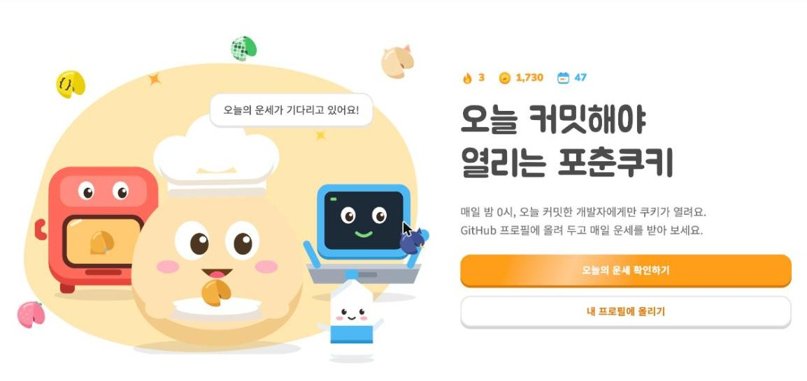
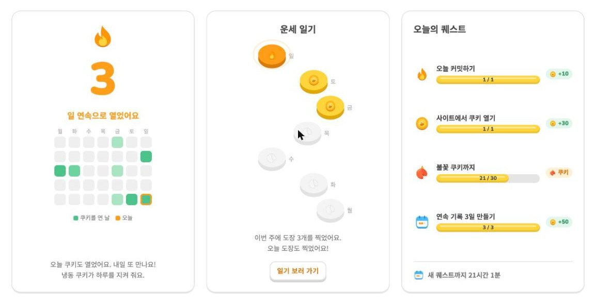
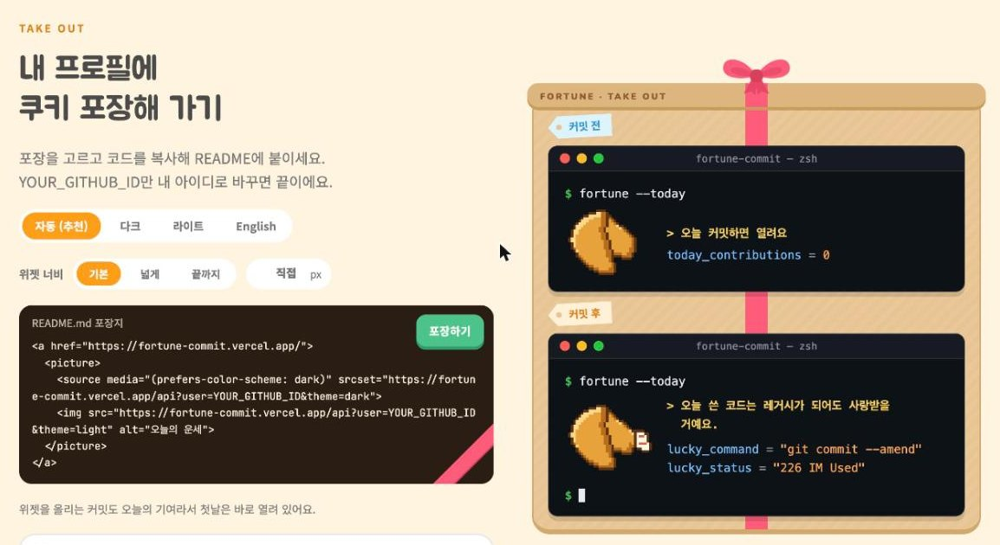
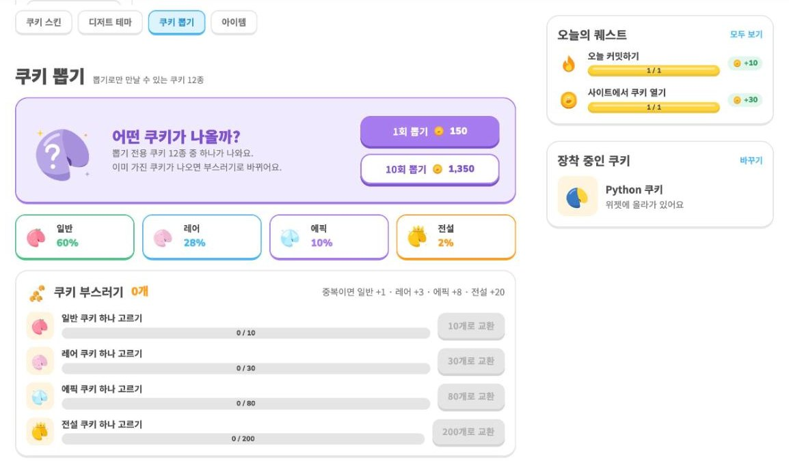
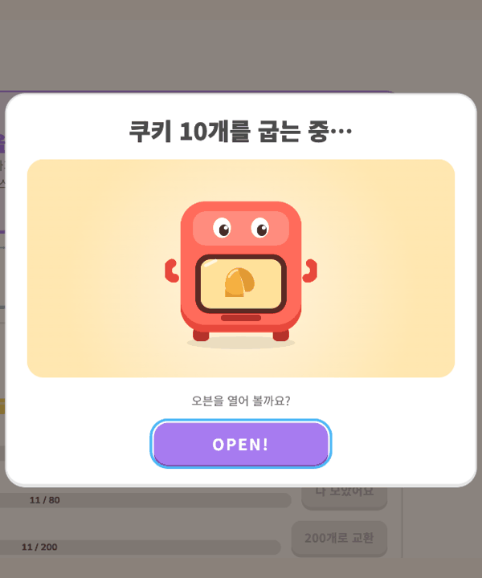
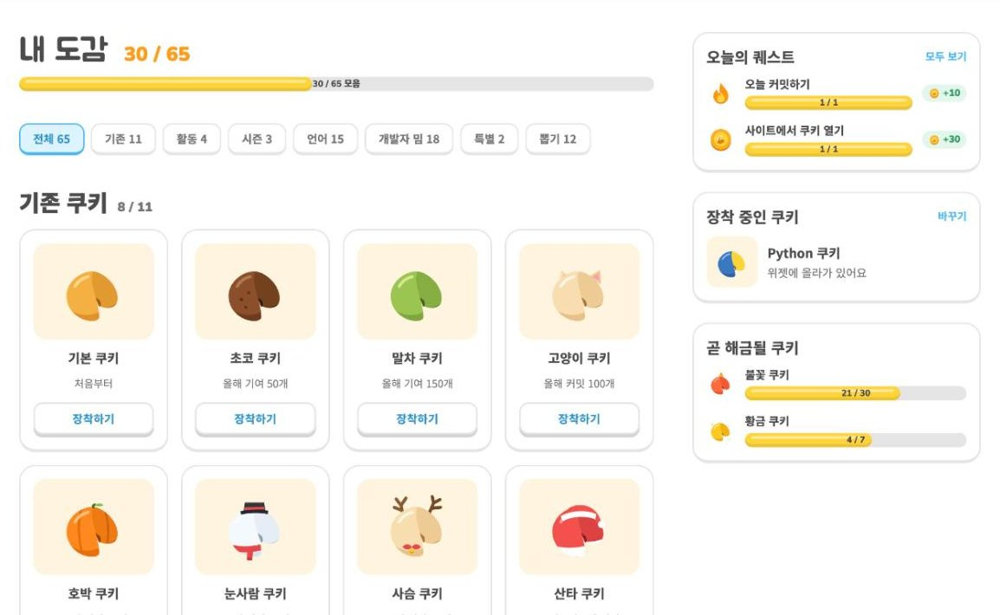
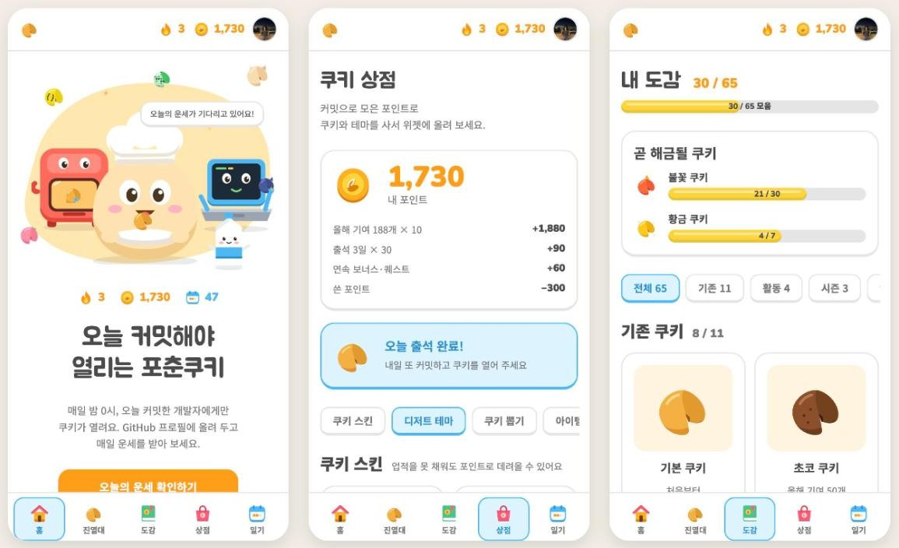

# 🥠 fortune-commit

> 오늘 커밋해야 열리는 포춘쿠키. GitHub 프로필 README에 붙이는 "오늘의 개발자 운세" 위젯과, 쿠키를 모으고 꾸미는 웹앱

- 사이트: https://fortune-commit.vercel.app
- 실습 과제 제출 시점: 태그 [`practice-submission`](https://github.com/2sseul/fortune-commit/tree/practice-submission) (2026-10-13, 커밋 56개)
- 이번 과제(v3) 계획: [`PRD_v2.md`](PRD_v2.md) · [`TODO_v2.md`](TODO_v2.md)

| 커밋 전 | 커밋 후 | 새 쿠키 (뽑기 왕관 쿠키) |
| :---: | :---: | :---: |
|  |  |  |

---

## 1. 제작한 것 소개

### 무엇인가

잔디(GitHub 기여 그래프)를 꾸준히 채우는 일에 **작은 이유**를 하나 만들어 주는 서비스입니다.
README에 붙인 포춘쿠키는 매일 밤 0시에 닫히고, 그날 커밋을 해야 갈라지면서 오늘의 운세를 보여줍니다.
커밋이 쌓이면 쿠키가 해금되고, 포인트로 쿠키를 뽑거나 사서 위젯에 올릴 수 있습니다.

### 실습 과제 시점과 비교해 달라진 점

실습 과제(v2.2, `practice-submission`) 이후 이번 과제(v3)에서 커밋을 40개 넘게 더 쌓았습니다.

| | 실습 과제 시점 (v2.2) | 지금 (v3) |
| --- | --- | --- |
| **디자인 방식** | 코드에서 바로 그리고 고치기 (메인을 세 번 갈아엎음) | **Figma에서 먼저 확정**(Figma MCP)하고 코드로 옮기기. PC·모바일 화면 8장, 디자인 변수·컴포넌트 |
| **사이트 스타일** | 픽셀 빵집 장면 | 듀오링고식 둥근 카드·3D 버튼, 움직이는 캐릭터(오븐이·커밋이·반죽이·우유) |
| **쿠키** | 픽셀 스킨 11종 | **65종** (언어 15·개발자 밈 18·시즌·뽑기 12 등). 사이트는 벡터, README 위젯은 벡터에서 **자동 변환한 픽셀** |
| **해금 기준** | 올해 활동만 | **가입한 날부터 전체 활동**, 조건에 '올해'가 붙은 쿠키만 올해. 언어 쿠키는 언어별 커밋 수로 여러 개 |
| **매일 하는 재미** | 출석 포인트 | 연속 기록(🔥)·잔디, 연속 보너스, **냉동 쿠키**, 오늘의 퀘스트, **운세 일기** 달력 |
| **포인트 쓰는 곳** | 스킨·테마 구매 | + **쿠키 뽑기**(오븐 연출, 확률 공개, 중복은 부스러기 → 원하는 쿠키로 교환), **AI 점쟁이**(OpenAI) |
| **위젯** | 너비 400~800 | 너비 495~1000 또는 **README 끝까지**, 비공개 저장소 기여(개수만)도 반영 |
| **휴대폰** | 탭 막대 | 320~430px 네 가지 폭에서 넘침 없이 확인한 반응형 |
| **링크 공유** | 제목만 | 링크를 보내면 뜨는 **미리보기 카드**(Open Graph · X, 1200×630 이미지) |
| **개발 과정** | 직접 배포 | **push → GitHub Actions 자동 테스트 → Vercel 자동 배포** |
| **테스트** | 72개 | 97개 |
| **Claude Code 스킬** | 없음 | 직접 만든 스킬 5개 (아래 4번) |

### 화면

**첫 화면** — 캐릭터들이 눈을 깜빡이고 팔을 흔들고, 떠다니는 쿠키는 누르면 돕니다. 오늘 쿠키를 이미 열었으면 버튼이 '오늘의 운세 확인하기'로 바뀝니다.



**매일 쌓이는 재미** — 연속 기록과 최근 5주 잔디, 이번 주 운세 일기 도장, 오늘의 퀘스트(보상은 자동 지급)



**포장해 가기** — 포장(자동 다크/라이트·다크·라이트·English)과 위젯 너비를 고르면 README 코드가 바뀝니다. '포장하기'를 누르면 복사돼요.



<table>
  <tr>
    <td width="50%"><b>쿠키 뽑기</b> — 확률을 공개하고, 결과는 서버에서 정합니다.<br></td>
    <td width="50%"><b>뽑기 연출</b> — 오븐 → OPEN → 연기 → 짜잔! (10회 뽑기 예시)<br></td>
  </tr>
  <tr>
    <td><b>내 도감</b> — 65종의 해금 상태·진행 막대, 곧 해금될 쿠키, 바로 장착<br></td>
    <td><b>휴대폰</b> — 위쪽 막대에 🔥·🍪, 아래 탭 막대(홈·진열대·도감·상점·일기)<br></td>
  </tr>
</table>

실습 과제 시점의 화면은 [`practice-submission` 태그의 README](https://github.com/2sseul/fortune-commit/tree/practice-submission#사이트-둘러보기)에서 볼 수 있습니다.

### 위젯 달기

포장해 가기에서 코드를 복사하거나, 아래처럼 붙이고 `YOUR_GITHUB_ID`만 바꾸면 됩니다.

```markdown
[](https://fortune-commit.vercel.app)
```

| 옵션 | 값 |
| --- | --- |
| `theme` | `dark`(기본) · `light` |
| `lang` | `ko`(기본) · `en` |
| `width` | `495`(기본·최소) ~ `1000`, `full`이면 README 끝까지 (``와 함께) |
| `skin` | 쿠키 이름 (해금했거나 산 쿠키만). 도감에서 장착하면 README를 고치지 않아도 바뀝니다 |
| `tz` · `radius` · `hide_border` | 하루가 바뀌는 시간대, 모서리, 테두리 |

### 실행하기

```bash
npm install
npm run dev     # http://localhost:3000 — Redis·GitHub 토큰 없이도 메모리 DB와 가짜 활동으로 로그인 화면까지 볼 수 있음
npm test        # 테스트 97개
```

---

## 2. PRD와 Todo 리스트

| 문서 | 다루는 범위 |
| --- | --- |
| [`PRD.md`](PRD.md) · [`TODO.md`](TODO.md) | v1 ~ v2.2 (실습 과제까지) |
| [`PRD_v2.md`](PRD_v2.md) · [`TODO_v2.md`](TODO_v2.md) | **v3.0 ~ v3.4 (이번 과제)**, 2026-10-31에 처음 계획 작성 |

PRD_v2를 함께 정한 뒤, 그 기능을 버전별 단계와 체크 항목으로 나눈 것이 TODO_v2입니다. 처음에는 **v3.0 디자인 → v3.1 → v3.2 → v3.3 → v3.4** 순서로 계획했습니다.

| 버전 | 목표 | 진행 (체크 항목, 삭제한 항목 제외) |
| --- | --- | --- |
| v3.0 빵집 다듬기 | Figma로 화면 확정, 코드로 옮기기, 움직임 | 18 / 24 |
| v3.1 빠르게, 더 많이 | 위젯 반영 속도, 비공개 기여, 운세 300개·등급 | 2 / 16 |
| v3.2 매일 쌓이는 기록 | 연속 기록, 운세 일기, 냉동 쿠키, 순위표 | 6 / 14 |
| v3.3 굽고 모으기 | 새 쿠키(4종 → 65종), ~~오븐~~ 쿠키 뽑기, AI 점쟁이 | 20 / 21 |
| v3.4 같이 보기 | 팀 위젯, 위젯 레이아웃 | 0 / 6 |

실제로는 계획 순서대로 가지 않았습니다. v3.0에서 Figma로 화면을 확정했는데, 그 화면에 연속 기록·뽑기·AI 점쟁이가 이미 들어 있었습니다. 그래서 '곧 열려요'로 비워 두는 대신, 화면을 코드로 옮기면서 **v3.2·v3.3 기능을 앞당겨 같이 만들었습니다**. 아직 남은 것은 운세 문구 300개·등급별 문구(v3.1), 순위표(v3.2), 팀 위젯(v3.4), 각 버전의 완성 기준 점검입니다.

---

## 3. Todo 리스트 변경 내역

TODO_v2에서는 **처음 계획을 지우지 않고** 바뀐 부분을 표시했습니다. (`todo-log` 스킬의 규칙)

| 표시 | 뜻 | 횟수 |
| --- | --- | :---: |
| `→ [수정 날짜]` | 계획을 바꿈 | 43 |
| `[테스트 후 변경 날짜]` | 만들어 보고(또는 배포해 보고) 바꿈 | 27 |
| `[추가 날짜]` | 처음 계획에 없던 것 | 27 |
| `~~취소선~~ [삭제 날짜]` | 하지 않기로 함 | 7 |

자세한 기록은 [`TODO_v2.md`](TODO_v2.md)의 버전별 '변경 내역·의견 기록'에 날짜와 이유를 함께 남겼습니다. 큰 변화만 모으면 다음과 같습니다.

### v3.0 디자인

| 처음 계획 | 실제 | 왜 |
| --- | --- | --- |
| 상점·도감·진열대를 **픽셀 빵집 장면**(카운터·앨범·쇼윈도)으로 | 픽셀 → 따뜻한 일러스트 → **듀오링고식 앱 화면** | 픽셀 장면 시안을 보고 별로라고 느낌. 이어서 듀오링고 디자인 시스템 같은 UI를 원함 (사용자 결정 2번) |
| 쿠키 스킨은 위젯과 같은 픽셀 | 사이트 쿠키는 **얼굴 없는 벡터**, 위젯만 픽셀 | "결국 이건 포춘쿠키니까" 눈·입은 빼고 단순한 벡터로 |
| PC 화면만 그리기 | **모바일 화면 4장** 추가 [추가] | 휴대폰에서 깨지지 않게 먼저 정해 두려고 |
| Figma에 SVG로 쿠키 올리기 | **PNG로** 올리기 [테스트 후 변경] | SVG의 clipPath가 Figma 앱에서 다르게 그려져 쿠키가 깨짐. MCP 스크린샷으로는 정상이라 늦게 발견 |
| v3.0은 디자인만 | 화면을 옮기면서 **v3.2·v3.3 기능까지 구현** [수정] | 확정한 화면에 그 기능들이 이미 있어서 (사용자 결정) |
| 화면 그림은 한 장짜리 이미지 | **부품으로 조립해 움직이는 그림** [테스트 후 변경] | "캐릭터들이 더 움직였으면" — 한 장 이미지로는 부분만 움직일 수 없음 |
| 휴대폰은 390px 스크린샷으로 확인 | 320·360·390·430px **네 폭을 한 번에 비교** [테스트 후 변경] | 브라우저 창이 줄지 않았고, 로그인 후 위쪽 막대가 360·390px에서 1px 넘치는 걸 이 방법으로 찾음 |
| (없음) | 쿠키 뽑기 연출, 선물 상자 포장, 이야기 구역 점선 길, 모달 스크롤 잠금 [추가] | 배포된 화면을 보고 한 사용자 의견 |

### v3.1 ~ v3.2 속도·기록

| 처음 계획 | 실제 | 왜 |
| --- | --- | --- |
| 비공개 저장소 반영 | 저장소 권한 없이 **비공개 기여 '개수'만** [수정] | 언어·시각까지 보려면 `repo` 권한이 필요한데, 권한은 받지 않기로 함 (사용자 결정) |
| 등급(대길~흉)은 문구 풀과 함께 | **등급 계산만 먼저** [수정] | 은하수 쿠키(전설 운세 날)와 일기 도장 색에 필요해서 |
| 일기에 운세 번호 저장 | **운세 문장 그대로** 저장 [수정] | AI 점쟁이 운세도 남기려고 |
| 냉동 쿠키 자동 사용 | **빼먹은 날보다 먼저 산** 냉동 쿠키만, 실제로 이어질 때만 [수정] | 긴 공백에 낭비되거나 사기 전 날을 메우지 않게 |
| (없음) | 글꼴 preconnect, API 중복 호출 제거, Redis 캐시 [테스트 후 변경] | "화면이 느리다" — 원인을 재 보니 글꼴 `@import`와 같은 GitHub 질의를 두 번씩 하던 것 |

### v3.3 쿠키·뽑기·AI

| 처음 계획 | 실제 | 왜 |
| --- | --- | --- |
| 새 쿠키 4종 (올빼미·주말·머지·불꽃) + 언어 3종 | **55종 → 65종** [수정] | 쿠키 시안을 보고 "이거 다 할래" |
| ~~오븐에 반죽 넣고 굽기~~ | **쿠키 뽑기** (확률 가챠, 중복 → 부스러기 → 교환) [삭제·추가] | 사용자 아이디어 |
| AI 점쟁이 300P, Claude API | **1,000P, OpenAI API** [수정] | 가격을 올리기로 함, 이후 OpenAI를 쓰기로 함 |
| 언어 쿠키: 주 언어 하나 | 언어별 커밋 수로 **여러 개** [테스트 후 변경] | 주 언어가 'Jupyter Notebook'으로 잡혀 하나도 안 열렸고, "하나밖에 못 여는 거 아니야?" |
| 해금은 올해 활동 | **가입한 날부터 전체**, '올해' 조건만 올해 [수정] | "처음 개설한 이후로 전부 확인하고, 올해 기준이면 올해로만" |
| 레트로 쿠키 = 기본 쿠키 픽셀 | **게임기 화면 속 초록 쿠키** [테스트 후 변경] | 기본 쿠키와 같아 보였고, 처음엔 색만 바꿨더니 말차 쿠키와 헷갈림 |
| (배포 후 확인) | 질의 형식 버그 수정, 첫 요청 9초 → 2.5초 [테스트 후 변경] | 배포된 위젯을 실제 계정으로 확인하다 발견 (로컬엔 GitHub 토큰이 없어 못 잡음) |

### 하지 않기로 한 것

사용자 운세 투고, PWA·푸시 알림, 포인트 환불·선물·거래, GitHub 토큰 저장·비공개 코드 읽기, 포인트 결제, 기존 캐릭터·다른 서비스 그래픽 ([`TODO_v2.md`](TODO_v2.md) '하지 않기로 한 것')

---

## 4. 스킬

이번 과제에서 [Claude Code 스킬](https://docs.claude.com/en/docs/claude-code/skills) 5개를 직접 만들어 `.claude/skills/`에 두었습니다. 같은 일을 할 때마다 같은 순서와 규칙으로 하게 만들고, 한 번 겪은 실수를 다시 하지 않게 하려는 목적입니다. 스킬을 쓰다가 맞지 않는 부분을 발견하면 바로 스킬을 고쳤습니다.

### 직접 만든 스킬

#### `todo-log` — TODO를 갱신하고 커밋하는 절차
- **SKILL.md 내용**: ① 처음 계획은 지우지 않고 `[x]` · `[추가]` · `→ [수정]` · `~~삭제~~` · `[테스트 후 변경]`으로 표시 ② 버전 끝 기록란에 날짜·이유 한 줄 ③ 스킬을 쓰면 '스킬 사용 기록'에 남기기 ④ `feat:/fix:/docs:` + 한국어로 커밋 ⑤ **push는 항상 물어보기**
- **어떻게 쓰였나**: 작업이 끝날 때마다 썼습니다. 사용자가 의견을 말하면 그 자리에서 이유와 함께 기록했고, 위 3번의 횟수(수정 43, 테스트 후 변경 27 등)가 이렇게 쌓였습니다.
- **왜 만들었나**: 과제의 'Todo 리스트 변경 내역'은 나중에 기억으로 쓰면 빠지는 것이 많습니다. 바뀔 때마다 같은 형식으로 남기게 해서, README 3번을 TODO_v2에서 그대로 모을 수 있게 했습니다.

#### `figma-to-site` — Figma 화면을 사이트 코드로 옮기는 절차
- **SKILL.md 내용**: 사이트 구조(빌드 없는 HTML·CSS, `site.css` 토큰, `site.js` 공통 부품), **여백 규칙**(카드 안쪽 16px, 쿠키 무대 120px, 바닥 칸 44px 등), Figma 컴포넌트 ↔ 코드 대응표, 옮기기 규칙(토큰 먼저, 쿠키는 그림으로 박지 않기, 기존 동작 유지), **Figma와 비교하는 방법**(PC와 휴대폰 네 폭, 넘침 검사)
- **어떻게 쓰였나**: v3.0-2에서 메인·상점·도감·진열대를 옮길 때 썼습니다. Figma 변수를 먼저 읽어 `site.css`를 같은 이름·값으로 만들고, 섹션마다 Figma 스크린샷을 정답으로 놓고 비교했습니다.
- **고친 것**: 써 보니 '사이트 구조' 설명이 v2(픽셀 쿠키) 기준이었고, '390px 스크린샷'으로는 브라우저 창이 줄지 않아 휴대폰 확인이 안 됐습니다. 컴포넌트 대응표와 '네 폭 iframe 비교'로 고쳤습니다.
- **왜 만들었나**: 실습 과제 때 코드에서 디자인을 여러 번 갈아엎었습니다. 페이지가 여러 개라 매번 같은 방식으로 옮겨야 사이트 전체가 한 디자인처럼 보입니다.

#### `pixel-skin` — 새 쿠키를 만들면 위젯 픽셀까지 자동으로
- **SKILL.md 내용**: ① `make.py`로 벡터 쿠키 그리기(얼굴 금지, 기호는 선으로) ② `to_pixel.py --missing`이 새로 생기거나 바뀐 쿠키만 위젯용 픽셀로 자동 변환(앞 조각·뒤 날개를 나눠 갈라지는 애니메이션 유지) ③ `preview.py`로 벡터·위젯 다크·라이트 확인 ④ Figma에는 PNG로 ⑤ `catalog.json` 등록 → `sync-cookies.mjs`로 사이트·서버에 반영
- **어떻게 쓰였나**: 뽑기 쿠키 10종을 만들 때 스킬 순서대로 진행했고, 레트로 쿠키를 다시 그릴 때도 썼습니다. 처음 `--missing`을 돌렸을 때 `make.py`가 모든 파일을 새로 써서 65개를 다 다시 변환했고, 바뀐 파일만 쓰게 고쳤습니다.
- **왜 만들었나**: 쿠키는 그림이 두 벌(사이트 벡터, 위젯 픽셀)이라, 하나만 고치면 위젯에서만 옛 쿠키가 나옵니다. "새 쿠키가 만들어지면 자동으로 픽셀 변환"하는 흐름을 사용자가 요청했습니다.

#### `fortune-writer` — 운세 문구 규칙과 검수
- **SKILL.md 내용**: 말투(~거예요), 길이, 겁주지 않기, 한국어·영어 같은 번호끼리 같은 뜻, 등급별·특별 운세 규칙, 검사 스크립트 `scripts/check-fortunes.mjs`
- **어떻게 쓰였나**: 검사 스크립트를 지금 문구 145개에 돌려 봤더니 "~거예요. 진짜로요."처럼 뒤에 한마디 붙인 문구 9개가 잘못 걸렸습니다. '문장 끝' 대신 '문장 안에 운세 표현이 있는지'로 규칙을 고쳤습니다. 문구를 300개로 늘리는 v3.1 작업은 아직 하지 않았습니다.
- **왜 만들었나**: 문구 수백 개를 AI가 쓰면 말투와 길이가 흔들리기 쉬워서, 기준과 자동 검사를 먼저 정해 두었습니다.

#### `release-check` — 버전을 마무리할 때 점검·배포
- **SKILL.md 내용**: 남은 일 확인 → 코드 점검(테스트, 보안) → 로컬에서 완성 기준 확인 → push(배포) → **배포된 사이트에서 다시 확인** → 기록
- **어떻게 쓰였나**: 버전의 '완성 기준 점검' 단계에서 쓰는 스킬인데, 아직 끝까지 마무리한 버전이 없어 정식으로 쓰지는 않았습니다. 다만 '배포된 사이트에서 다시 확인' 단계는 매번 따랐고, 그 덕분에 실제 GitHub에서만 나는 질의 버그와 첫 요청 9초 문제를 찾았습니다.
- **왜 만들었나**: 로컬에서 되던 것이 배포에서 안 되는 경우(환경변수, 실제 GitHub 데이터)를 놓치지 않으려고 만들었습니다.

### 가져다 쓴 스킬

| 스킬 | 어디서 | 어떻게 쓰였나 · 고른 이유 |
| --- | --- | --- |
| `skill-creator` | Claude Code | 스킬 5개 초안을 만들 때. SKILL.md 형식과 '언제 불려야 하는지' 설명을 제대로 쓰려고 |
| `figma-use` · `figma-generate-design` | Figma MCP | Figma에 변수·글자 스타일·컴포넌트를 만들고 화면을 조립할 때. 자동 레이아웃 카드가 접히는 문제를 스킬 규칙대로 고침 |
| `claude-api` | Claude Code | AI 점쟁이를 처음 Claude API로 만들 때, 모델 이름과 요청 형식을 기억에 의존하지 않으려고. 이후 OpenAI로 바꿈 |

---

## 5. 느낀점, 결론

<!-- 직접 작성: 쓸 거리 예시
- Figma에서 디자인을 먼저 확정하는 방식(v3)과 코드에서 바로 고치던 방식(v2)의 차이
- 스킬을 직접 만들고 쓰면서 달라진 점, 스킬을 고치게 된 순간
- TODO를 지우지 않고 변경 내역을 남겨 보니 어땠는지
- 계획 순서대로 가지 않은 부분(v3.2·v3.3을 앞당긴 것)에 대한 생각
- 배포해 보고서야 발견한 문제들 (로컬에선 안 보이던 것)
-->

(작성 예정)
