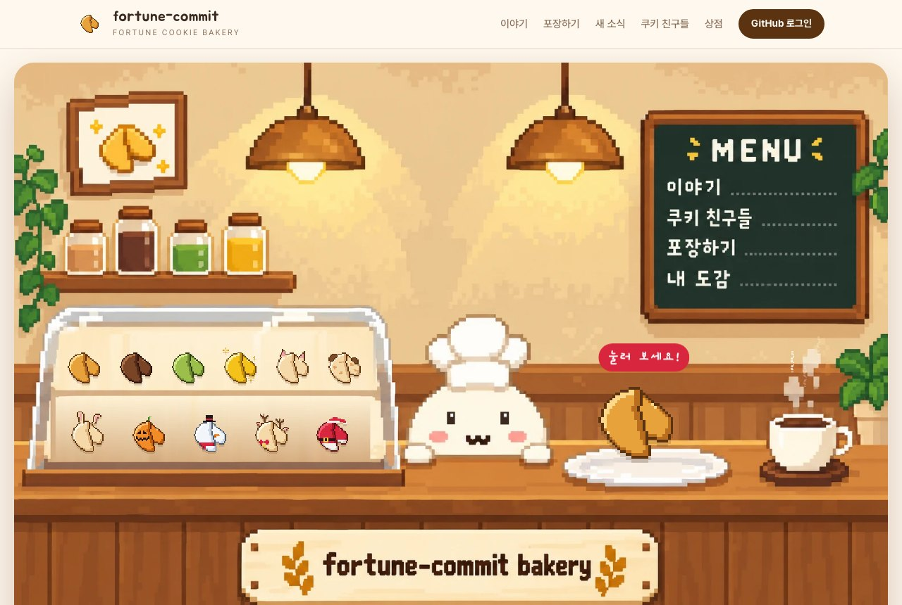
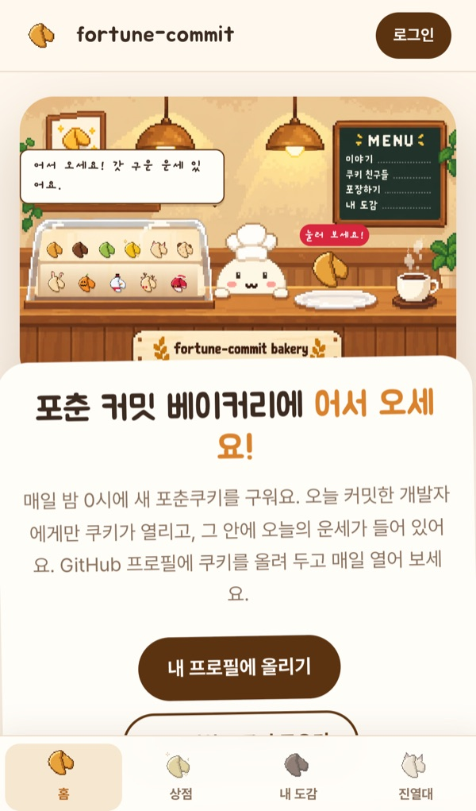
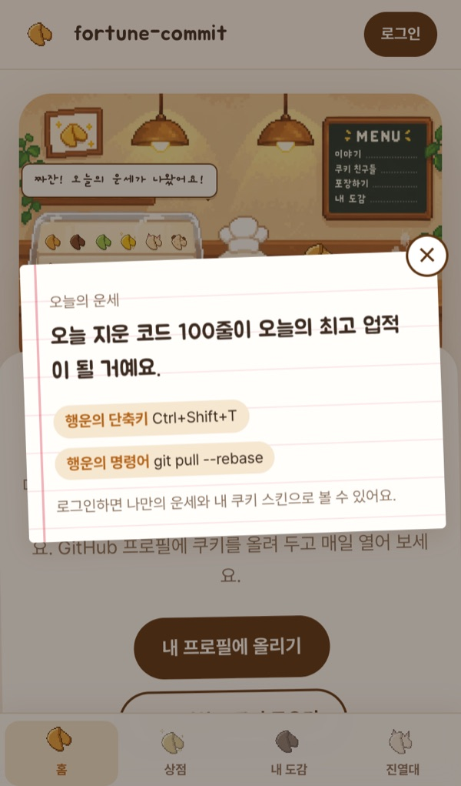
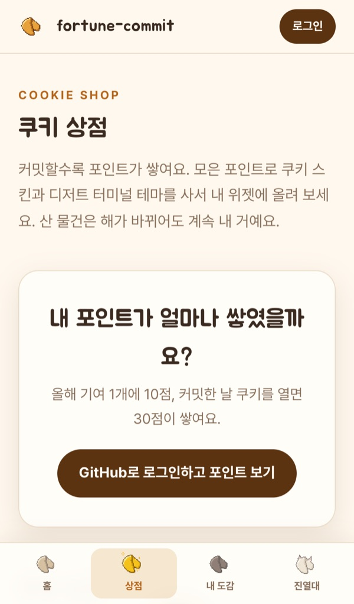
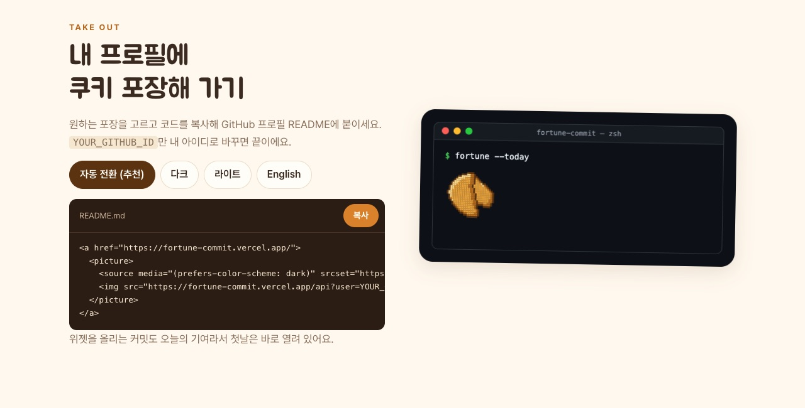
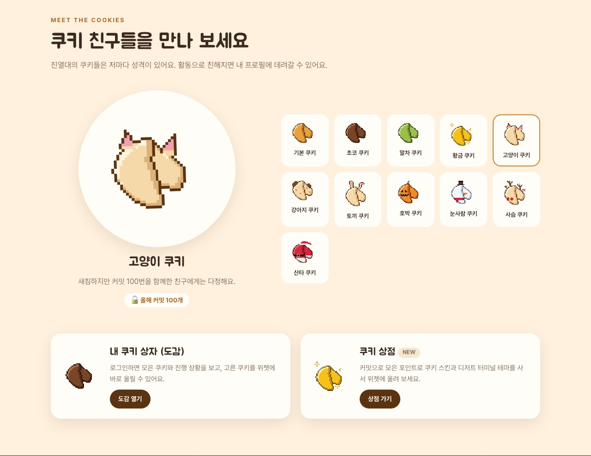
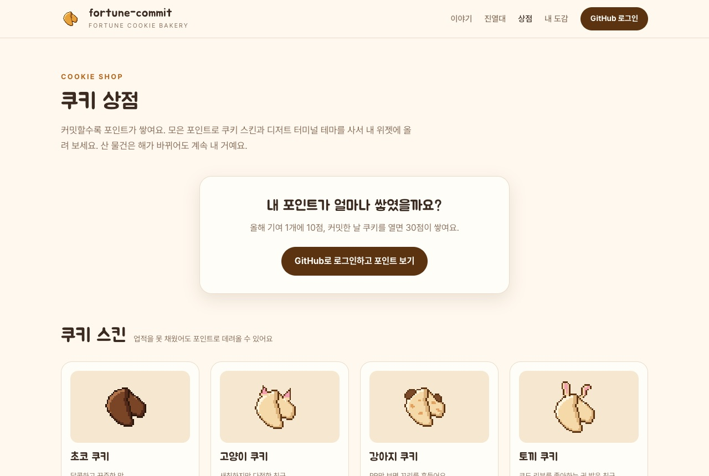
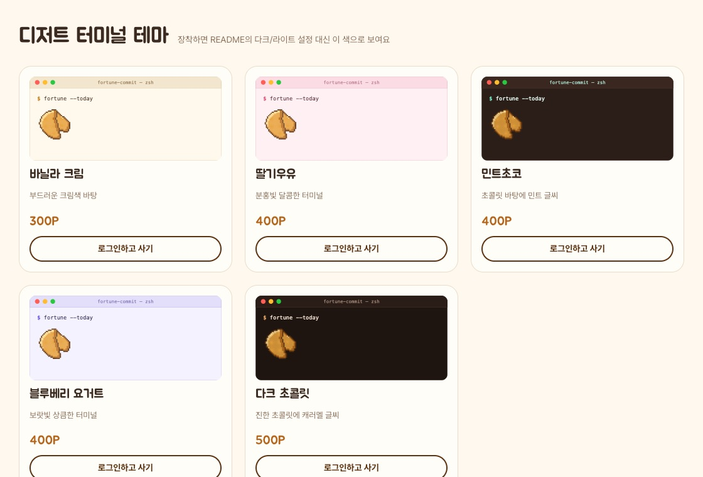
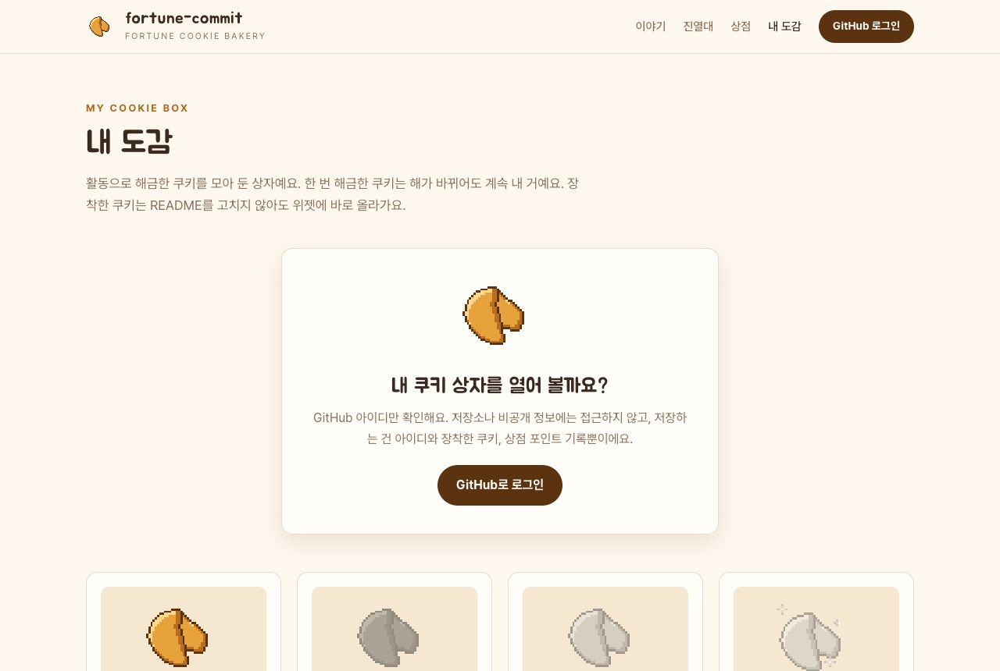
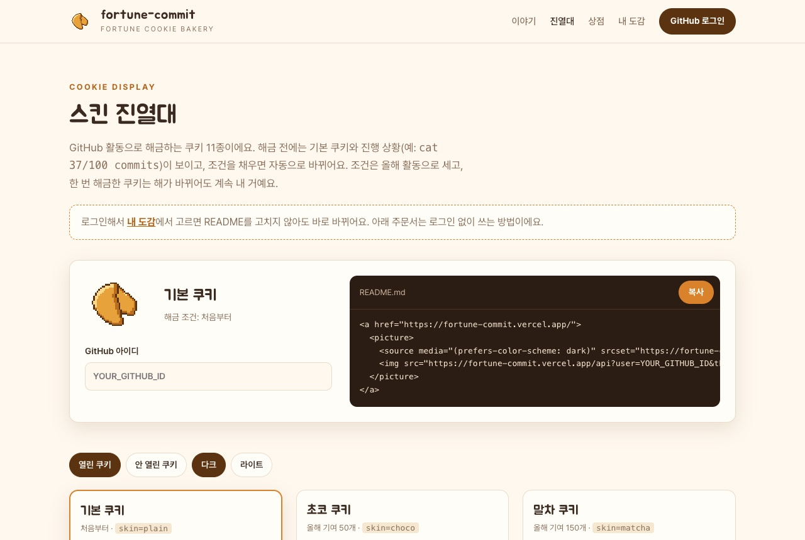

# 🥠 fortune-commit

> 오늘 커밋해야 열리는 포춘쿠키. GitHub 프로필 README에 붙이는 "오늘의 개발자 운세" 위젯과, 쿠키 스킨을 모으고 꾸미는 웹앱

| 커밋 전 (닫힌 쿠키) | 오늘의 내 쿠키 |
| :---: | :---: |
| [](https://fortune-commit.vercel.app) | [](https://fortune-commit.vercel.app) |

---

## 1. 제작한 것 소개

### 왜 만들었나

잔디(GitHub 기여 그래프)를 꾸준히 채우는 건 생각보다 어렵습니다. 하루쯤 건너뛰어도 아무 일도 일어나지 않으니까요.

fortune-commit은 그 하루에 **작은 이유**를 하나 만들어 줍니다. 프로필에 붙여 둔 포춘쿠키는 매일 밤 0시에 닫히고, 그날 커밋을 해야만 갈라지면서 오늘의 운세를 보여줍니다. 커밋을 쌓을수록 고양이, 호박, 산타 같은 쿠키 스킨이 해금되고, 포인트로 상점에서 스킨과 터미널 테마를 살 수도 있습니다. "오늘 운세 뭐 나오나 보자"는 가벼운 호기심이 매일의 커밋으로 이어지길 바랐습니다.

### 주요 기능

| 기능 | 설명 |
| --- | --- |
| 커밋하고 열기 | 매일 한국 시간 0시에 쿠키가 잠기고, 그날 공개 활동(push, PR, 이슈, 리뷰 등)을 하면 쿠키가 갈라지며 운세가 나옴 |
| 오늘의 운세 | `GitHub 아이디 + 날짜`로 정해지는 나만의 운세(한국어·영어 105개씩), 지난 7일 활동과 주 사용 언어에 맞춘 문구, `lucky_status = "200 OK"` 같은 행운 아이템 |
| 터미널 + 픽셀 위젯 | 터미널 창에서 `$ fortune`을 실행하면 픽셀 쿠키가 갈라지는 SVG 애니메이션. 다크/라이트, 한국어/English, 크기·모서리·시간대 옵션 |
| 쿠키 스킨 11종 | 고양이(올해 커밋 100개), 호박(10월 기여 10개), 산타(크리스마스 기여) 등 활동으로 해금. 해금 전에는 진행 상황 표시, 한 번 해금하면 계속 내 것 |
| 로그인 · 도감 | GitHub로 로그인해서 도감에서 쿠키를 고르면 README 수정 없이 위젯에 바로 반영. 다른 사람은 내 설정을 바꿀 수 없음 |
| 포인트 · 쿠키 상점 | 기여 1개당 10점, 커밋한 날 쿠키를 열면 출석 30점. 포인트로 스킨과 디저트 터미널 테마(딸기우유, 민트초코 등)를 사서 장착 |
| 픽셀 빵집 메인 | 직접 그린 픽셀 빵집 장면. 마스코트 반죽이의 눈이 마우스를 따라오고, 접시 위 쿠키를 누르면 운세 쪽지가 나옴 |
| 모바일 | 휴대폰에서는 아래 탭 막대(홈·상점·내 도감·진열대)로 앱처럼 사용 |

### 사이트 둘러보기

배포 링크: https://fortune-commit.vercel.app

#### 픽셀 빵집 메인



직접 그린 픽셀 빵집이 첫 화면이에요. 마스코트 반죽이의 눈이 마우스를 따라오고, 반죽이를 누르면 말을 걸어요. 접시 위 쿠키를 누르면 오늘의 운세 쪽지가 나오고, 커밋한 날 쿠키를 열면 출석 포인트 30점을 받아요. 칠판 메뉴로 이야기·쿠키 친구들·포장하기·내 도감으로 바로 갈 수 있어요.

#### 휴대폰에서

<table>
  <tr>
    <td align="center"></td>
    <td align="center"></td>
    <td align="center"></td>
  </tr>
  <tr>
    <td align="center">메인 화면</td>
    <td align="center">쿠키를 누르면 나오는 운세 쪽지</td>
    <td align="center">쿠키 상점</td>
  </tr>
</table>

휴대폰에서는 위 메뉴 대신 아래 탭 막대(홈·상점·내 도감·진열대)가 생겨서 앱처럼 쓸 수 있어요. 헤더는 한 줄로 줄이고, 운세 쪽지는 화면 가운데에 띄우고, 카드는 두 칸으로 놓았어요.

#### 쿠키 포장해 가기



자동 전환·다크·라이트·English 중에서 포장을 고르면 README 코드가 바뀌고, 복사 버튼으로 가져가면 돼요. 오른쪽 터미널은 실제 위젯 미리보기라 누르면 쿠키가 갈라지는 애니메이션을 다시 볼 수 있어요.

#### 쿠키 친구들



진열대의 쿠키 11종을 하나씩 눌러 보면 성격 소개와 해금 조건(예: 올해 커밋 100개)이 나와요. 아래에서 도감과 상점으로 넘어갈 수 있어요.

#### 쿠키 상점





GitHub로 로그인하면 내 포인트(기여 1개당 10점 + 출석 30점)가 보이고, 업적을 못 채운 쿠키 스킨도 포인트로 살 수 있어요. 바닐라 크림, 딸기우유, 민트초코 같은 디저트 터미널 테마도 팔아요. 산 물건은 해가 바뀌어도 계속 내 거예요.

#### 내 도감



| 스킨 | `skin=` | 해금 조건 (올해, 기준 시간대) |
|---|---|---|
| 기본 쿠키 | `plain` | 처음부터 |
| 초코 쿠키 | `choco` | 기여 50개 |
| 말차 쿠키 | `matcha` | 기여 150개 |
| 황금 쿠키 | `gold` | 7일 연속 기여 |
| 고양이 쿠키 | `cat` | 커밋 100개 |
| 강아지 쿠키 | `dog` | PR 10개 |
| 토끼 쿠키 | `rabbit` | 코드 리뷰 10개 |
| 호박 쿠키 | `pumpkin` | 10월에 기여 10개 |
| 눈사람 쿠키 | `snowman` | 12월에 기여 10개 |
| 사슴 쿠키 | `deer` | 12월에 기여 30개 |
| 산타 쿠키 | `santa` | 12월 25일(크리스마스)에 기여 |

로그인하면 해금한 쿠키와 아직 잠긴 쿠키의 진행 상황을 한눈에 볼 수 있어요. 여기서 쿠키를 장착하면 README를 고치지 않아도 위젯에 바로 반영돼요. 저장하는 건 GitHub 아이디, 장착한 쿠키, 상점 포인트 기록뿐이에요.

#### 스킨 진열대



로그인 없이 쓰는 방법이에요. GitHub 아이디를 넣고 스킨을 고르면 `skin=`이 들어간 README 코드가 만들어지고, 열린/안 열린 쿠키와 다크/라이트 모습을 미리 볼 수 있어요.

### 위젯 달기

아래 한 줄을 README에 붙여 넣고, `YOUR_GITHUB_ID`를 본인 GitHub 아이디로 바꾸세요. (아래 자동 전환 버전은 두 군데)
위젯을 누르면 fortune-commit 소개 페이지가 열려요.

```md
[](https://fortune-commit.vercel.app)
```

#### 다크/라이트 모드 자동 전환 (추천)

GitHub를 다크 모드로 보는 사람에게는 다크 터미널, 라이트 모드로 보는 사람에게는 라이트 터미널을 보여줍니다.

```html
<a href="https://fortune-commit.vercel.app">
  <picture>
    <source media="(prefers-color-scheme: dark)" srcset="https://fortune-commit.vercel.app/api?user=YOUR_GITHUB_ID&theme=dark">
    
  </picture>
</a>
```

#### 이렇게 보여요

| 오늘 기여 전 | 오늘 기여 후 |
| :---: | :---: |
|  |  |
| 안 열린 쿠키 + `오늘 커밋하면 열려요` | 쿠키가 갈라지며 오늘의 운세와 행운 아이템 |

- 위젯을 다는 커밋도 오늘의 기여로 세져서, **첫날은 바로 열려 있어요.** 다음 날부터는 커밋해야 열립니다.
- 커밋 후 열리기까지 몇 분 걸릴 수 있어요. (GitHub가 기여를 반영하는 시간 + 이미지 캐시 5분)
- 쿠키를 여는 '오늘 활동'은 **한국 시간 0시부터의 공개 활동**(push, PR·이슈 열기, 코드 리뷰, 새 저장소)으로 세요. 비공개 저장소 활동으로는 열리지 않아요. (GitHub 잔디는 UTC 날짜로 기록돼서, 한국 0시를 정확히 맞추려고 활동 시각이 남는 공개 이벤트를 써요)
- `user`를 빼면 잠금 없이 모두에게 같은 '그날의 공통 운세'가 나옵니다.

다른 테마와 언어 예시는 **[예시 갤러리](https://fortune-commit.vercel.app)** 에서 보고 바로 복사할 수 있어요.

## 2. PRD랑 Todo 리스트

- [PRD.md](./PRD.md) · 무엇을, 누구를 위해, 왜 만드는지 (v1 → v2 → v2.1 → v2.2 버전별로 추가)
- [TODO.md](./TODO.md) · 버전마다 단계로 나눈 할 일 목록과 진행 상황, 맨 끝에는 개발 중 생긴 아이디어·의견·수정사항 기록

### 진행 상황

| 버전 | 내용 | 상태 |
| --- | --- | --- |
| v1 | 터미널 + 픽셀 쿠키 위젯, 오늘의 운세, 옵션, 커밋하고 열기 | 완료 |
| v2.0 | 활동으로 해금하는 쿠키 스킨 11종 | 완료 |
| v2.1 | GitHub 로그인, 도감, 장착하면 바로 반영, 메인 페이지 | 완료 |
| v2.2 | 포인트와 쿠키 상점, 한 번 해금하면 영원히, 모바일 화면 | 완성 기준 점검 중 |

## 3. 방법론의 장단점

### 장점

- **우선순위 정하기 편했음.** PRD에 "꼭 있어야 하는 기능"이랑 "만들지 않는 것"을 먼저 적어 놨더니, 중간에 새 아이디어가 떠올라도 지금 할지 다음 버전으로 미룰지 바로 정할 수 있었음.
- **AI가 내 말을 잘 알아들었음.** 목적, 사용자, 기능, 완성 기준이 문서에 다 있어서 매번 길게 설명 안 해도 AI가 내가 원하는 대로 작업했음.
- **AI 실수랑 다시 하는 일이 줄었음.** 범위랑 완성 기준이 정해져 있으니까 엉뚱한 기능을 만들거나 다 뜯어고치는 일이 별로 없었음.
- **방향이 안 흔들렸음.** v1 → v2 → v2.1 → v2.2로 기능이 계속 늘어났는데도, PRD랑 TODO가 기준이 돼서 처음 콘셉트("커밋해야 열리는 쿠키")에서 벗어나지 않았음.
- **MVP를 빨리 뽑을 수 있었음.** v1 범위를 작게 잡아서 하루 만에 위젯 배포하고 내 프로필에 붙일 수 있었음. 나머지 기능은 직접 써 보면서 하나씩 더했음.

### 단점

- **큰 그림, 특히 디자인이랑 취향은 결국 내가 정해야 따라왔음.** PRD에 분위기를 글로 적어 놔도 AI가 원하는 느낌을 잘 못 맞췄음. 메인 페이지는 "AI가 만든 사이트 같음" → 베이커리 → Dumb Ways to Die 스타일 → 되돌리고 구성만 가져오기까지 여러 번 갈아엎었고, 위젯이랑 쿠키 스킨도 내가 직접 그림 그려서 보여주고 나서야 마음에 드는 게 나왔음.
- **문서만으로는 실제로 돌려 봐야 아는 문제를 못 잡았음.** README에서는 JavaScript가 안 돼서 PRD에 넣었던 "눌러서 열기"를 만들었다가 버렸음. GitHub 기여가 UTC 날짜라 한국 0시에 쿠키가 안 잠기는 문제, 공개 이벤트가 늦게 반영되는 문제도 배포하고 다음 날 직접 확인해 보고서야 알았음. PRD를 아무리 꼼꼼히 써도 직접 돌려 보는 건 꼭 해야 함.

## 4. 개선이 필요한 점

- **디자인 더 다듬고 싶음.** 메인 빵집 장면은 마음에 들게 나왔는데, 상점·도감·진열대 페이지는 아직 카드만 늘어놓은 느낌이라 빵집 느낌이 덜함. 밝은 바탕에서 산타 모자 흰 털이 잘 안 보이는 것처럼 작은 픽셀 쿠키도 손볼 데가 남아 있고, 그림으로 바꾸면서 빠진 조명 흔들림 같은 움직임도 다시 넣어 보고 싶음.
- **쿠키 열리는 조건이랑 반영 속도.** 지금은 공개 저장소 활동만 세서 비공개 저장소에서만 작업하는 사람은 쿠키를 못 엶. 커밋하고 위젯이 열리기까지 몇 분 걸리고(GitHub 반영 시간 + 이미지 캐시), 도감에서 쿠키를 장착해도 GitHub 이미지 캐시 때문에 프로필에 바로 안 바뀔 때가 있음. 장착하면 캐시 자동으로 비우는 기능은 아직 아이디어로만 남아 있음.
- **매일 다시 오게 만드는 기능이 아직 약함.** 지금은 포인트랑 상점이 거의 유일한 동기라서, 아이디어로 적어 둔 운세 일기(달력 도장, 연속 기록), 홈 화면에 앱처럼 설치(PWA), 알림, 순위표, 연속 출석 보너스 같은 걸 더 넣어 보고 싶음.
- **운세 문구가 고정돼 있음.** 한국어·영어 105개씩이라 오래 쓰면 같은 운세가 또 나옴. 문구를 계속 늘리거나, 처음에 빼 놨던 사용자가 운세를 직접 올리는 기능도 다시 생각해 볼 만함.

## 5. 결론

처음엔 PRD랑 TODO 쓰는 게 그냥 코드 바로 짜는 것보다 느릴 거라고 생각했음. 근데 AI랑 같이 만들어 보니까 문서가 AI한테 일 시키는 지시서이면서, 내가 뭘 원하는지 스스로 정리하는 도구였음. "만들지 않는 것"이랑 "완성 기준"을 적어 둔 덕분에 AI가 혼자 앞서 나가지 않았고, 하루 만에 실제로 배포되는 위젯을 만들 수 있었음.

그렇다고 문서로 다 정할 수 있는 건 아니었음. 디자인은 글로 몇 번을 설명해도 엇나갔는데 그림 한 장 보여주니까 바로 통했고, 시간대나 캐시 문제는 문서가 아니라 직접 써 보면서 찾았음. 바이브 코딩에서 내 역할은 코드를 직접 짜는 것보다 **뭘 만들지 정하고, 원하는 걸 정확히 전달하고, 결과를 직접 확인하는 것**에 더 가깝다고 느꼈음.

작은 위젯 하나로 시작했는데 로그인, 도감, 상점까지 있는 웹 서비스가 됐음. 매일 커밋하게 만들려고 만든 쿠키가 진짜로 내 잔디를 채우고 있다는 게 제일 뿌듯했음. 다음엔 디자인 시안을 먼저 정하고 실제 환경에서 빨리 돌려 보는 식으로, 덜 갈아엎으면서 만들어 보고 싶음.
